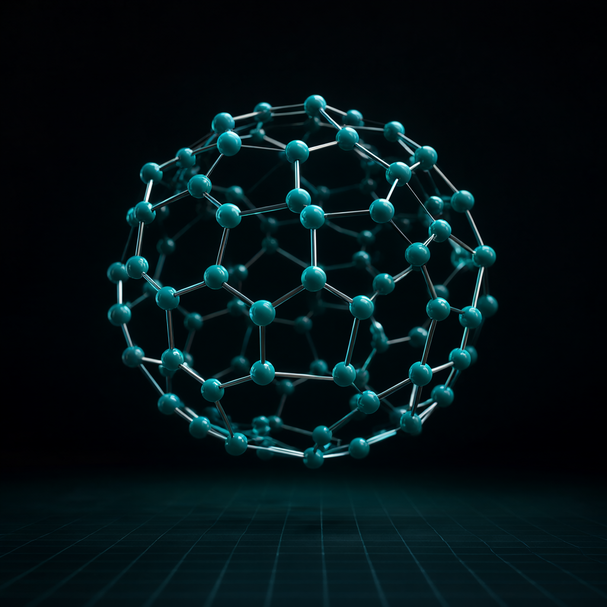

# Molecular Studio — 3D Molecular Modeling Platform

> **Live Demo:** [https://ugabuga-mu.vercel.app](https://ugabuga-mu.vercel.app)




[](https://bun.sh)
[](https://react.dev)
[](https://threejs.org)
[](https://www.typescriptlang.org)
[](#license)

Build interactive molecules in real 3D: add atoms, create bonds, drag
structures, inspect live chemical data, and export your work.
Built for a vibe code jam — frontend only, no backend, no database, no keys.



## Run it

```bash
bun install
bun run dev      # dev server (http://localhost:5173)
bun run build    # production build → dist/
bun run preview  # serve the production build
bun run lint     # oxlint
bun run format   # prettier
```

Requires [Bun](https://bun.sh) 1.x.

## Features

**3D visualization** (React Three Fiber + Three.js)

- Orbit / zoom / pan with damped controls, auto-rotate showcase mode
- 3 display modes: Ball & Stick, Space Fill (van der Waals radii), Wireframe
- Studio lighting rendered locally (no external HDR download), starfield,
  soft contact shadows, camera auto-frames every molecule
- Thermal vibration mode: atoms jiggle with per-atom phase offsets
- Net-dipole arrow on polar molecules

**Interactive editor**

- Tools: Select (drag atoms on a camera-facing plane), Add (auto-bonds at
  real covalent lengths), Bond (two-click gesture), Delete
- 13-element palette with true CPK colors; undo/redo across 50 steps
- Bond order cycling Single / Double / Triple; geometric auto-bond detection
- Adjustable atom size and bond thickness, toggleable atom labels

**Inspector panel**

- Hill-notation formula with real subscripts, molar mass, element
  composition bars
- Per-atom data: atomic number, mass, electronegativity, covalent + vdW
  radii, phase, electron configuration, live position, bond angles
- Per-bond data: length, ΔEN, polarity class (nonpolar / polar / ionic)
- Molecule stats: polarity with dipole moment, radius of gyration

**Library, sharing, export**

- 13 presets from water to C60 buckyball (generated truncated-icosahedron
  geometry, validated bond graph), surprise-me random loader, empty scene
- XYZ file export, PNG snapshots, URL share links (`#m=` payload)
- Keyboard shortcuts (see below), fullscreen mode, mobile-friendly layout

## Keyboard shortcuts

| Key | Action |
| --- | ------ |
| `V` / `A` / `B` / `D` | Select / Add / Bond / Delete tool |
| `Ctrl+Z` / `Ctrl+Shift+Z` | Undo / redo |
| `Esc` | Deselect, cancel pending bond, close library |

## Preset library

Water, carbon dioxide, oxygen, nitrogen, hydrogen fluoride, methane,
ammonia, ethene, ethyne, benzene, methanol, ethanol, buckminsterfullerene
(C60). Every preset ships with explicit bond orders; geometry is validated
by `scripts/validate-presets.ts` (`bun scripts/validate-presets.ts`).

## Tech stack

| Layer | Choice |
| ----- | ------ |
| Runtime | Bun 1.x |
| 3D | three, @react-three/fiber, @react-three/drei |
| UI | React 19, Tailwind CSS 4, motion, lucide-react |
| State | zustand (with capped undo history) |
| Quality | TypeScript strict, oxlint, prettier |

## Project structure

```text
molstudio/
├── src/
│   ├── components/scene/   # Canvas, editor gestures, atom/bond meshes,
│   │                       # camera rig, dipole arrow
│   ├── components/ui/      # Top bar, tool rail, inspector, library, hints
│   ├── lib/                # chemistry math, element data, presets, share links
│   ├── store/              # zustand molecule store + history
│   ├── App.tsx             # layout, shortcuts, share-link boot
│   └── index.css           # theme tokens, glass panels
├── scripts/validate-presets.ts
├── public/                 # icon set, cover art, animated demo
└── CHANGELOG.md
```

## License

Jam demo — free to explore and remix.
